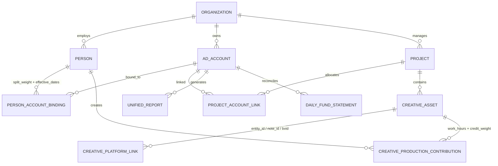

# AdLink — Enterprise Ad-Data Governance & AI-Native MCP Middleware in Rust

[简体中文](README.md) | **English**

[](https://github.com/zyfjacksonchen-source/adlink/actions/workflows/ci.yml)
[](LICENSE)
[](Cargo.toml)
[-brightgreen.svg)](docs/platform-api-mapping.md)

> **Digitization is the prerequisite for being AI-Native.** **AdLink** (Apache-2.0, commercially permissive open source) is a high-performance, cleanly decoupled **Rust** middleware that bridges **15 mainstream global & Chinese ad platforms (10 domestic CN connectors + 5 overseas connectors)** with ISO-4217 multi-currency FX conversion, customized enterprise ad-data governance, universal multi-transport AI Agent MCP tooling (24 tools), and a commercial high-concurrency production server.

[中文版 README](README.md) · [Agent Onboarding Playbook (EN)](AGENT_GUIDE.en.md) · [Agent 接入引导 (中文)](AGENT_GUIDE.md) · [Agent Skill (SKILL.md)](SKILL.md) · [Field-by-Field API Audit](docs/platform-api-mapping.md) · [Architecture](docs/architecture.md) · [Plugin SDK](docs/plugin-development.md)

---

## 1. Purpose & Industry Value

When advertisers, agencies, and **FDEs (Forward Deployed Engineers)** push toward AI-native media operations, raw API plumbing quickly hits three production blockers:
1. **Fragmented Protocols, Units & Currencies**: China domestic platforms (Tencent, Ocean Engine, Kuaishou, Xiaohongshu, Bilibili, Alipay) and global platforms (TikTok, Meta, Google, Apple Search Ads, Amazon) mix monetary units (Fen / Yuan / Li / `micros` / `cents` + USD/EUR/GBP/JPY multi-currency), chunk windows (`1d` / `7d` / `30d` / `31d` / `90d`), and auth schemes (OAuth2, `Bearer + X-Call-Source`, Alipay RSA2, Google `developer-token`, Apple `ES256` P-256 JWT).
2. **Raw Logs Cannot Power Enterprise AI**: Without effective-dated **Person–Account bindings (`人-户关系`)**, **Project classifications (`项目分类`)**, **Creative taxonomy & internal creator labor attribution (`创意工时归因`)**, and clear **Spend vs. Performance vs. Custom Calibers (`财务口径`)**, AI agents only inspect unreconciled spreadsheets.
3. **Cross-Agent Integration Duplication**: Enterprise teams need one governed, rate-limited, safety-guarded MCP & headless API foundation shared across **Claude Code, Codex, Antigravity, Cursor, WorkBuddy, KimiWork, TraeWork, 豆包工作, 千问办公, GrokBot, Muse, Dots**, and custom orchestrators.

---

## 2. Why AdLink When Ad Platforms Already Offer Official MCPs?

> **In one sentence**: Official platform MCPs only answer *"Can an AI call one media vendor's raw endpoints?"*; **AdLink solves the hard integration gap between fragmented multi-platform media data and your highly customized internal governance (person-account attribution splits, project taxonomy, finance calibers, and creative labor ROI)** — eliminating bespoke glue code at every customer deployment.

| Dimension | Official Platform MCPs Only | **AdLink Enterprise Middleware + Official MCPs** |
| :--- | :--- | :--- |
| **Auth & Onboarding Cost** | Separate OAuth pages, token refresh, and key handling per vendor | **Two-tier login: reuse Official MCP auth bridge first (`official_mcp_bridge`), or fall back to direct API account discovery** |
| **Ownership & Project Mapping** | Only raw vendor account IDs | **Freely re-label (`重标`) `PersonAccountBinding` (effective dates + split weights) and `ProjectAccountLink`, or bootstrap custom projects in 1 call** |
| **Multi-Currency & Calibers** | Mixing Fen/Yuan/Li/Micros/Cents with no rebate or grant separation | **Canonical `Fen` + `[fx_rates]` FX conversion, Spend/Performance/Full-Funnel calibers, and safe Custom AST DSL formulas** |
| **Creative Labor & Seeding ROI** | No internal scriptwriter/shooter/editor hours or cross-platform seeding join | **Aggregates `gmv_per_work_hour_yuan` and links `note_id`/`bvid` organic KOL orders with paid boost traffic** |
| **Write & Ad Creation Safety** | Exposed write endpoints risk accidental budget burn | **Ad creation disabled by default (`enabled=false`); mandatory user ask + 5 risk warnings; forced `PAUSED` + `dry_run` preview + hard caps + audit log** |

### Two-Tier Login Architecture (Official MCP Bridge First + Direct API Fallback)

```mermaid
flowchart LR
    A["Connect Ad Platform / Start Onboarding"] --> B{"Official Platform MCP Available?"}
    B -- "Yes · Optimal (Tier 1)" --> C["Reuse Official MCP Auth Endpoint<br/>(`auth_strategy = official_mcp_bridge`)"]
    C --> D["`adlink_discover_platform_accounts`<br/>Pull authorized accounts"]
    D --> E["`adlink_relabel_account_governance`<br/>Re-label Person-Account splits & Project links in AdLink"]
    B -- "No · Fallback (Tier 2)" --> F["Query Marketing API Sub-Account List<br/>(`auth_strategy = direct_api_account_discovery`)"]
    F --> G["`adlink_fallback_bootstrap_project`<br/>Create custom project & bind selected sub-accounts"]
    E --> H["Caliber Reconciliation · Creative ROI · 24 Universal MCP Tools"]
    G --> H
```

---

## 3. Target Audience

| Persona | Primary Pain Point | How AdLink Helps |
| :--- | :--- | :--- |
| **Brand / Advertiser FDE & AI Transformation Leads** | Building a single AI-ready data & ad-ops foundation across agents | Turnkey Docker/K8s server + 3 MCP transports + safety guardrails (`dry_run`, budget caps, immutable audit log) |
| **Agency Tech / Ops / Media Directors** | Tracking optimizer split weights, rebates, agency fees, cash vs. grant, project margin | Effective-dated `人-户关系` + Project classification + Spend/Performance/Custom caliber reconciliation |
| **Creative & Content Team Leads** | Measuring copywriter/videographer/editor/designer ROI and KOL seeding + boost lift | Custom hook/format taxonomy + `note_id`/`bvid` cross-platform attribution + `gmv_per_work_hour_yuan` |
| **Ad-Tech Engineers** | Reliable Marketing API connectors, long-window chunked backfills, extensibility | Zero-loss `raw_fields` retention + pure-Rust Alipay RSA2 & Apple ES256 signers + Cordis-style plugin SDK |

---

## 4. Core Architecture (DeepSeek-Harness / Cordis-Inspired Microkernel)

```mermaid
flowchart TB
    subgraph Agents["Multi-Agent & Client Layer"]
        A1["International Coding Agents: Claude Code · Codex · Antigravity · Cursor"]
        A2["China Workspace Agents: WorkBuddy · KimiWork · TraeWork · 豆包工作 · 千问办公"]
        A3["Personal & Orchestrators: GrokBot · Muse · Dots · Dify · Coze · LangGraph"]
        A4["Custom Frontends: Web Starter Console (web-starter/) · WeChat/UniApp MiniProgram SDK"]
    end

    subgraph Transport["Unified Protocol, Guardrails & High-Concurrency Server (adlink-mcp + adlink-api)"]
        T1["MCP Stdio (stderr logs) · Streamable HTTP (/mcp) · Legacy SSE (/sse)"]
        T2["Headless REST /api/v1/* · Async Job Queue /sync/jobs/enqueue (202) · OpenAPI 3.1"]
        T3["Load Shedding (503) · Per-Tenant Rate Limiting (429) · Timeout (504) · Idempotency-Key"]
        T4["Epoch-Invalidated Analytics Cache (X-Cache) · Prometheus (/metrics) · Probes (/healthz /readyz)"]
        T5["Bearer / X-Api-Key Auth Middleware & X-Request-Id Correlation"]
    end

    subgraph Kernel["Microkernel Plugin Bus (adlink-kernel · Cordis Pattern)"]
        K1["Scoped Dependency Injection (PluginContext / ServiceRegistry)"]
        K2["Reversible EffectScope Rollback Stack"]
        K3["HookPipeline: BeforeApiRequest / AfterNormalizeRow / BeforeAdMutate / BeforeAdCreate"]
        K4["GuardrailPlugin: Opt-In Ad Creation Gate · 5 Risk Warnings · Hard Caps · Audit Trail"]
    end

    subgraph Engine["Concurrency Engine & SQLite WAL Pool (adlink-engine + adlink-domain + adlink-storage)"]
        E1["DateRangeChunker (1d/7d/30d/31d/90d) & Hierarchical RateLimiterPool"]
        E2["Resumable SyncCoordinator · Bounded Async Worker Pool · Webhook Dispatcher"]
        E3["FxRateTable Multi-Currency Normalization & Safe Caliber AST Engine"]
        E4["SQLite WAL Reader/Writer Pool (Serialized Writer + write_epoch + N Read-Only Connections + Checkpoint)"]
    end

    subgraph Connectors["15 Global & China Ad Platform Connector Plugins (adlink-connectors)"]
        C1["China (10): Tencent AMS v3 · XHS Juguang/Chengfeng/Pugongying · Bilibili Sanlian/Huahuo"]
        C2["China: Kuaishou v1 · Ocean Engine AD & Local v3 · Alipay Denghuo (Pure-Rust RSA2)"]
        C3["Global (5): TikTok v1.3 · Meta v21.0 · Google v18 (GAQL) · Apple Search Ads v5 (ES256) · Amazon v3"]
    end

    Agents --> Transport
    Transport --> Kernel
    Kernel --> Engine
    Engine --> Connectors
```



### Enterprise Data Governance Model



---

## 5. Supported Platforms (15 Connectors = 10 Domestic CN + 5 Global Overseas)

> Full parameter rules, creation capabilities, and vendor deprecation notices: **[docs/platform-api-mapping.md](docs/platform-api-mapping.md)**.

### Global Overseas Platforms (5 Connectors · Normalized via `[fx_rates]` to Base CNY `Fen`)

| Platform | Connector ID | API Version & Auth | Unit Conversion & Critical Upstream Details | Max Window | Canonical / Official Fields |
| :--- | :--- | :--- | :--- | :--- | :--- |
| **TikTok Ads** | `tiktok_ads` | Marketing API `v1.3` (`Access-Token`) | Report `spend` & budgets in account major currency × FX -> `Fen` | 30 days | `spend`, `impressions`, `clicks`, `complete_payment`, `total_complete_payment_value` |
| **Meta Ads (FB/IG)** | `meta_ads` | Graph API `v21.0` (`Bearer`) | Insights in major decimal strings (prioritizes `omni_purchase`); `/campaigns` & `/adsets` mutations convert automatically to minor **cents** | 30 days | `spend`, `impressions`, `clicks`, `actions[]`, `action_values[]` |
| **Google Ads** | `google_ads` | Google Ads API `v18` (`Bearer` + `developer-token` + MCC `login-customer-id`) | GAQL `googleAds:searchStream`; converts `costMicros` (`1e-6`) × FX -> `Fen` & creation budgets to micros | 90 days | `metrics.costMicros`, `metrics.conversions`, `metrics.conversionsValue` |
| **Apple Search Ads** | `apple_search_ads` | Ads API `v5` (**Pure-Rust ES256 JWT** + `X-AP-Context`) | Signs ES256 P-256 `client_secret` natively; `localSpend.amount` × FX -> `Fen` *(⚠️ Apple sunset notice: Jan 2027)* | 30 days | `localSpend`, `impressions`, `taps`, `tapInstalls` |
| **Amazon Ads** | `amazon_ads` | Ads API `v3` (`Bearer` + `Amazon-Ads-ClientId` + `Scope`) | Async `/reporting/reports` (`PENDING` yields `AsyncTaskPending`) *(⚠️ Amazon v3 unified migration: Jun 2027)* | 31 days | `cost`, `purchases14d`, `sales14d`, `advertisedAsin` |

### China Domestic Platforms (10 Connectors)

| Platform | Connector ID | API Mode | Max Window | Official Units -> Canonical CNY `Fen` | Core Official Fields |
| :--- | :--- | :--- | :--- | :--- | :--- |
| **Tencent Ads (AMS v3.0)** | `tencent_ads` | Public MAPI v3.0 | 90 days | Fen -> `Fen` | `cost`, `view_count`, `valid_click_count`, `conversions_count`, `cheout_fd`, `cheout_pv_1d` |
| **Xiaohongshu Juguang** | `xhs_juguang` | Partner OpenAPI | 30 days | Fen / Yuan string -> `Fen` | `fee`, `impression`, `click`, `interaction`, `note_id`, `convert_cnt` |
| **Xiaohongshu Chengfeng** | `xhs_chengfeng` | Partner OpenAPI | 30 days | Fen / Yuan string -> `Fen` | `fee`, `impression`, `click`, `deal_order_num`, `deal_order_gmv`, `note_id` |
| **Xiaohongshu Pugongying** | `xhs_pugongying` | Partner API / Structured Ingest | 30 days | Fen -> `Fen` (`note_id` join) | `order_id`, `note_id`, `kol_quote_fee`, `platform_service_fee` |
| **Bilibili Sanlian / Qifei** | `bilibili_sanlian` | Commercial Partner MAPI | 30 days | Fen -> `Fen` | `cost`, `impression`, `click`, `play_cnt`, `like_cnt`, `bvid` |
| **Bilibili Huahuo** | `bilibili_huahuo` | Partner API / Structured Ingest | 30 days | Fen -> `Fen` (`bvid` join) | `huahuo_order_id`, `bvid`, `order_amount`, `platform_fee`, `gmv` |
| **Kuaishou Magnetic Engine** | `kuaishou` | Public MAPI v1 | 7 days | Yuan (report) / **Li (`Fen*10`)** (create) | `charge`, `show`, `photo_click`, `event_pay`, `event_pay_purchase_amount`, `photo_id` |
| **Ocean Engine AD v3.0** | `ocean_engine_ad` | Public MAPI v3.0 | 30 days | Yuan -> `Fen` | `stat_cost`, `show_cnt`, `click_cnt`, `pay_order_amount`, `material_id` |
| **Ocean Engine Local Ads v3.0** | `ocean_engine_local` | Public MAPI v3.0 | 30 days | Yuan -> `Fen` | `stat_cost`, `show_cnt`, `click_cnt`, `pay_order_amount`, `poi_id`, `local_life_verify_cnt` |
| **Alipay Denghuo** | `alipay_denghuo` | Public OpenAPI (**Pure-Rust RSA2**) | 7 days (1d hourly) | Fen -> `Fen` | `cost`, `impression`, `click`, `conv_result`, `conversion_data_list` |

> **Compliance & Zero-Loss Commitment**: Neither `xhs_pugongying` nor `bilibili_huahuo` exposes an unapproved public self-serve MAPI. AdLink never scrapes or bypasses platform controls; it pairs whitelisted partner endpoints with structured ingestion (`POST /api/v1/ingest`) and retains every raw vendor field (plus `original_currency`, `fx_rate_to_base`, and `original_spend`) in `unified_reports.raw_fields_json`.

---

## 6. Commercial High-Concurrency Server Architecture

Built across `adlink-storage`, `adlink-api`, and `adlink-cli` for multi-tenant production workloads:
- **SQLite WAL Reader/Writer Separation Pool**: Single serialized transactional writer that atomically increments `write_epoch` on commit, paired with a configurable read-only connection pool (`storage.reader_pool_size = 8`, `PRAGMA query_only = ON`, `mmap_size = 256MB`) and clean `PRAGMA wal_checkpoint(TRUNCATE)` on exit.
- **Epoch-Invalidated Analytics Cache (`AnalyticsQueryCache`)**: Millisecond-fast read-through caching (`X-Cache: HIT|MISS`) on `/api/v1/analytics/query`, `/api/v1/analytics/reconcile`, and `/api/v1/attribution/creatives`, automatically invalidated in O(1) whenever any storage write bumps `write_epoch`.
- **`Idempotency-Key` Deduplication**: Safe replay protection (`X-Idempotency-Replayed: true`) on `/api/v1/ingest`, `/api/v1/sync/jobs/enqueue`, `/api/v1/ad-ops/mutate`, and `/api/v1/ad-creation/create`.
- **Backpressure, Rate Limiting & Hardening**: Adaptive in-flight concurrency semaphore (`503 Service Unavailable` + `Retry-After`), per-tenant API-key/IP token bucket (`429 Too Many Requests`), request timeouts (`504`, preserving `/sse` long-lived streams), `DefaultBodyLimit`, `X-Request-Id`, and security response headers.
- **Bounded Async Worker Queue, Webhooks & Scheduler**: `POST /api/v1/sync/jobs/enqueue` returns `202 Accepted` immediately and executes on background workers (`GET /api/v1/sync/jobs/{id}`), with optional `webhook_url` notifications and periodic sync scheduling.
- **Cloud-Native Probes, Prometheus Telemetry & Graceful Drain**: `GET /healthz`, `GET /readyz` (flips to `503` immediately on `SIGTERM`/`SIGINT`), `GET /metrics` (Prometheus text exposition), structured JSON/text `stderr` logs, worker draining, and WAL checkpointing.

---

## 7. One-Stop Installation & Production Deployment

### Option A: Build & Run Mock Sandbox in Minutes

```bash
git clone https://github.com/zyfjacksonchen-source/adlink.git
cd adlink

cargo build --release -p adlink-cli

# Unified Server: REST + Streamable HTTP /mcp + Legacy SSE /sse + Web Console + /metrics
# Automatically seeds governance, creatives, and 30 days across all 15 platforms
./target/release/adlink serve --config config/adlink.mock.toml --seed-mock
```

Endpoints once running:
- **Web Console**: `http://127.0.0.1:8787/`
- **MCP Streamable HTTP**: `http://127.0.0.1:8787/mcp`
- **MCP Legacy SSE**: `http://127.0.0.1:8787/sse`
- **Probes & Prometheus Metrics**: `http://127.0.0.1:8787/healthz` · `/readyz` · `/metrics`
- **OpenAPI 3.1 Spec**: `http://127.0.0.1:8787/api/v1/openapi.json`
- **Schema-Driven UI Contract**: `http://127.0.0.1:8787/api/v1/ui/schema`

### Option B: Docker, Nginx & Kubernetes Deployment

```bash
cp config/adlink.example.toml config/adlink.local.toml

# Single-node Docker
docker compose up -d --build

# Production stack (Nginx keepalive + non-buffered SSE/MCP + internal-only /metrics)
docker compose -f docker-compose.prod.yml up -d --build

# Kubernetes StatefulSet (PVC WAL storage + /readyz drain + Prometheus scrape annotations)
kubectl apply -f deploy/k8s-deployment.yaml
```

### Common CLI Commands

```bash
adlink doctor --config config/adlink.mock.toml
adlink sync --config config/adlink.mock.toml --start 2026-05-01 --end 2026-10-27 --concurrency 16
adlink mcp-config --client claude-code
adlink mcp-config --client workbuddy
```

---

## 8. Universal AI Agent MCP Matrix & Guardrails

AdLink supports **Stdio**, **Streamable HTTP (stateful & stateless)**, and **Legacy SSE**:

| Client Category | Examples | Recommended Transport | Config Template |
| :--- | :--- | :--- | :--- |
| **Coding Agents** | Claude Code, OpenAI Codex, Antigravity, Cursor | `adlink mcp-stdio` or `/mcp` | [stdio-desktop-clients.json](config/agents/stdio-desktop-clients.json) · [codex.toml](config/agents/codex.toml) |
| **China Office / Workspace Agents** | WorkBuddy, KimiWork, TraeWork, 豆包工作, 千问办公 | Streamable HTTP (`/mcp`) / Legacy SSE (`/sse`) / Stdio | [streamable-http-clients.json](config/agents/streamable-http-clients.json) |
| **Personal Agents** | GrokBot, Muse, Dots | Streamable HTTP (`/mcp`) / Stdio | `adlink mcp-config --client grokbot` |
| **Enterprise Orchestrators** | Dify, Coze, FastGPT, LangGraph, Custom Agents | `/mcp` or `/api/v1/openapi.json` | [openapi.rs](crates/adlink-api/src/openapi.rs) |

### Agent Onboarding & Default-Off Opt-In Ad Creation (`创编`)

Your AI agent can read **[AGENT_GUIDE.en.md](AGENT_GUIDE.en.md)** / **[AGENT_GUIDE.md](AGENT_GUIDE.md)** and **[SKILL.md](SKILL.md)** or call AdLink's **24 MCP tools**. Programmatic **Ad Creation (`adlink_ad_create` / `POST /api/v1/ad-creation/create`) is disabled by default (`enabled = false`, `risk_acknowledged = false`)**:
- Agents MUST first ask the user: *"Do you want to enable Ad Creation (creating campaigns/adgroups/creatives via API)?"*
- Agents MUST disclose all **5 risks**: (1) real budget spend & unit differences (Kuaishou `li`, Tencent/XHS `fen`, Ocean Engine/TikTok major currency, Meta `cents`, Google `micros`); (2) ad review rejection / account suspension; (3) targeting / URL / pixel attribution mismatch; (4) platform structural & whitelist constraints (Tencent v3.0 2-tier model; XHS/Bilibili whitelists; Alipay/Pugongying/Huahuo have no public self-serve creation API); (5) even when explicitly opted in, entities always default to `PAUSED`, require a `dry_run = true` preview + `preview_confirmed = true`, budget/bid hard caps, and immutable audit logging.

---

## 9. Financial Calibers & Creative Workload Attribution

- **Spend Calibers**: `gross_media_cost_yuan` (cash + grant), `cash_cost_yuan`, `net_after_rebate_cost_yuan` (`gross * (1 - rebate_rate)`), and `full_funnel_cost_yuan` (`gross + kol_order_fee + platform_service_fee + creative_production_cost`).
- **Performance Calibers**: `agency_gross_billing_yuan`, `agency_net_revenue_yuan` (rebates + service fees), `platform_gmv_yuan`, `gross_roi`, `full_funnel_roi`.
- **Custom AST DSL Calibers**: Safely evaluated pure-Rust formulas, e.g. `safe_div(gmv_yuan, net_after_rebate_yuan + kol_order_fee_yuan + platform_service_fee_yuan)`.
- **Creative Labor Attribution**: Tracks `work_hours` and `credit_weight` across Scriptwriter, Shooter, Editor, and Designer roles to compute per-creator `gmv_per_work_hour_yuan`, alongside `note_id`/`bvid` closed-loop seeding+boost attribution.

---

## 10. Customizable Web & MiniProgram Frontends

Replace the zero-build starter UI in `web-starter/` (plus WeChat/UniApp MiniProgram helper `web-starter/miniprogram-sdk/adlink-mp.js`) with any React/Vue/Next.js bundle via `--web-dir ./my-dist`, driven dynamically by `GET /api/v1/ui/schema`.

---

## 11. License

Licensed under the **[Apache License 2.0](LICENSE)** — free for commercial deployment, enterprise integration, and derivative products. See [LICENSE](LICENSE) and [NOTICE](NOTICE).
