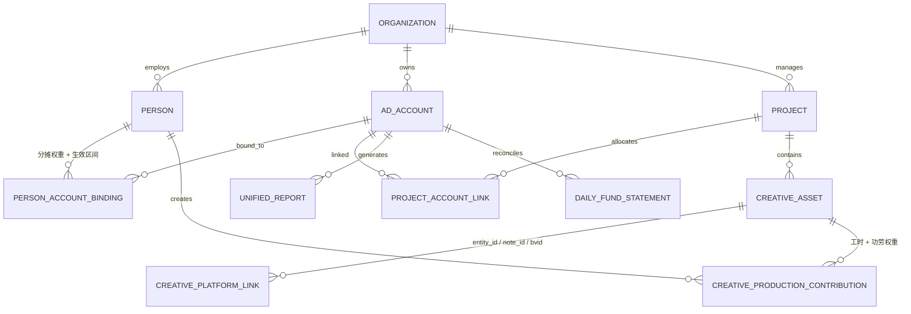

# AdLink — 广告投放数据底座与 AI-Native MCP 中间件

> **数字化是 AI Native 的前提。** AdLink（Apache-2.0 开源可商用）是一个用 **Rust** 构建的高性能、高度解耦的广告数据治理与 MCP 中间件，打通 **8 大主流国内广告/内容营销平台（10 个逻辑连接器）** 与企业内部数据、人户治理及多端 AI Agent 生态。

[English README](README.en.md) · [Agent API 接入引导手册 (AGENT_GUIDE)](AGENT_GUIDE.md) · [Agent Skill (SKILL.md)](SKILL.md) · [架构设计](docs/architecture.md) · [插件二开指南](docs/plugin-development.md)

---

## 1. 项目目的与行业意义

广告主与代理商在推进 **FDE（Forward Deployed Engineer / 商业数字化交付）与 AI 化转型** 时，往往卡在最底层的工程现实：
1. **媒体协议碎片化、字段不统一**：腾讯、巨量、快手、小红书、B站、支付宝各平台单位不一致（分 vs 元）、时间跨度上限不同（1天/7天/30天/90天）、鉴权迥异（OAuth2 / Bearer+X-Call-Source / RSA2 签名）。
2. **只拉流水进不了生产环境**：没有理清 **人-户关系（含生效期与分摊权重）**、**项目类型分类**、**创意类型分类与内部创作者工时归因**、以及 **消耗口径 / 业绩口径 / 自定义口径** 的数据，AI Agent 拿到的只是一堆无法对账的脏表。
3. **跨 Agent 重复造轮子**：WorkBuddy、KimiWork、TraeWork、豆包工作、千问办公、Claude Code、Codex、Antigravity、Cursor、GrokBot、Muse、Dots 以及自建 Agent 需要统一、可控、带安全护栏的 MCP 底座。

**AdLink 的价值**：
- **一站式部署，开机即用**：内置官方字段级模拟数据，部署后立即可完整体验分析、口径对账、归因与多端 MCP；当用户准备接入真实账户时，内建 `AGENT_GUIDE` 与 `adlink_onboard_guide` 工具会主动引导用户的 AI Agent 手把手完成官方 API 连接。
- **DeepSeek Harness（Cordis）微内核插件思想**：Everything is a Plugin —— 存储、连接器、安全护栏、口径公式、MCP 工具集全部通过作用域 `PluginContext` 挂载、依赖注入、钩子拦截并在卸载时可逆回滚（`EffectScope`）。
- **极致性能与高并发长日期引擎**：Rust 异步并发调度 + 平台自适应日期切片 + 分级令牌桶限流 + 退避重试 + SQLite WAL 事务批量 Upsert + 断点续传，轻松处理跨半年/全年的长日期批量拉数。

---

## 2. 适用人群

| 角色 | 核心诉求 | AdLink 提供的核心能力 |
| :--- | :--- | :--- |
| **品牌/广告主 FDE 与 AI 转型负责人** | 搭建企业投放数据基座，让办公/代码 Agent 安全查数与调价 | 一站式容器部署 + MCP 三协议接入 + 安全护栏（默认 `dry_run` + 预算封顶 + 审计日志） |
| **广告代理商技术 / 运营 / 媒介负责人** | 理清优化师/媒介人-户绑定、返点、服务费、现金/赠款、项目毛利 | 人户关系时效分摊 + 项目类型分类 + 消耗/业绩/自定义口径自动对账 |
| **创意/内容团队负责人** | 量化编导/拍摄/剪辑/设计工时投入与投放 ROI，打通种草+加热 | 创意分类打标 + `note_id`/`bvid` 跨平台归因 + 创作者单小时产出 GMV |
| **广告媒体研发人员** | 快速对接官方 Marketing API、长日期并发拉数与二次开发 | 官方字段映射零丢失保留 (`raw_fields`) + 纯 Rust 支付宝 RSA2 签名 + 插件化二开 |

---

## 3. 核心架构图 (DeepSeek-Harness / Cordis 微内核思路)

```mermaid
flowchart TB
    subgraph Agents["多端 AI Agents & 客户端层"]
        A1["国内办公 Agent: WorkBuddy · KimiWork · TraeWork · 豆包工作 · 千问办公"]
        A2["国际编程 Agent: Claude Code · Codex · Antigravity · Cursor"]
        A3["Personal & 自建 Agent: GrokBot · Muse · Dots · Dify/Coze"]
        A4["用户自定义前端: Web 控制台 (web-starter/) · 微信/UniApp 小程序 SDK"]
    end

    subgraph Transport["统一协议与入口层 (adlink-mcp + adlink-api)"]
        T1["MCP Stdio (纯 stderr 日志)"]
        T2["MCP Streamable HTTP (/mcp, 兼容有状态与无状态)"]
        T3["MCP Legacy SSE (/sse + /messages)"]
        T4["Headless REST /api/v1/* + OpenAPI 3.1 + UI Schema"]
        T5["Bearer / X-Api-Key 鉴权中间件"]
    end

    subgraph Kernel["微内核插件总线 (adlink-kernel · Cordis 理念)"]
        K1["PluginContext 作用域依赖注入 (ServiceRegistry)"]
        K2["可逆副作用栈 (EffectScope 自动回滚)"]
        K3["HookPipeline: BeforeApiRequest / AfterNormalizeRow / BeforeAdMutate / AfterAdMutate"]
        K4["GuardrailPlugin: 预算上限 · 批量上限 · 强制操作原因 · 审计记录"]
    end

    subgraph Engine["高并发引擎与治理计算 (adlink-engine + adlink-domain + adlink-storage)"]
        E1["日期切片器 DateRangeChunker (1d/7d/30d/90d)"]
        E2["分级令牌桶 RateLimiterPool (平台级 + 账户级)"]
        E3["断点续传 SyncCoordinator + 重试退避 RetryPolicy"]
        E4["安全公式 AST 引擎 (消耗口径 / 业绩口径 / 自定义口径)"]
        E5["SQLite WAL 事务批量写入 + 归因查询引擎"]
    end

    subgraph Connectors["8 大媒体官方连接器插件层 (adlink-connectors)"]
        C1["腾讯社交广告 AMS v3.0"]
        C2["小红书聚光 & 乘风"]
        C3["小红书蒲公英 (合规白名单/导表)"]
        C4["B站三连/起飞 & 花火商单"]
        C5["快手磁力引擎 v1"]
        C6["巨量引擎 AD & 本地推 v3.0"]
        C7["支付宝灯火 (纯 Rust RSA2)"]
    end

    Agents --> Transport
    Transport --> Kernel
    Kernel --> Engine
    Engine --> Connectors
```



### 企业数据治理模型（人-户关系 · 项目分类 · 创意归因）



---

## 4. 支持的 8 大主流媒体平台与官方字段对齐

| 平台 | 连接器 ID | 接入性质 | 官方基础域名 / 协议 | 货币单位归一化 | 最大单次切片 | 核心官方字段保留 |
| :--- | :--- | :--- | :--- | :--- | :--- | :--- |
| **腾讯社交广告** | `tencent_ads` | 公开 MAPI v3.0 | `https://api.e.qq.com/v3.0` (OAuth2) | 分 -> `Fen` | 90 天 | `cost`, `view_count`, `valid_click_count`, `conversions_count`, `cheout_fd`, `time_line` |
| **小红书聚光** | `xhs_juguang` | 合作方 OpenAPI | `https://adapi.xiaohongshu.com` (`Access-Token`) | 分 -> `Fen` | 30 天 | `fee`, `impression`, `click`, `interaction`, `note_id`, `convert_cnt` |
| **小红书乘风** | `xhs_chengfeng` | 合作方 OpenAPI | `https://adapi.xiaohongshu.com` (`Access-Token`) | 分 -> `Fen` | 30 天 | `fee`, `impression`, `click`, `deal_order_num`, `deal_order_gmv`, `note_id` |
| **小红书蒲公英** | `xhs_pugongying` | 白名单 / 导表合规打通 | Partner API 或 `/api/v1/ingest` | 分 -> `Fen` | 30 天 | `order_id`, `note_id`, `kol_quote_fee`, `platform_service_fee`, `read_cnt`, `like_cnt`, `collect_cnt` |
| **B站三连/起飞** | `bilibili_sanlian` | 合作方 MAPI | `https://cm.bilibili.com/takumi/api` (`Bearer` + `X-Call-Source`) | 分 -> `Fen` | 30 天 | `cost`, `impression`, `click`, `play_cnt`, `like_cnt`, `coin_cnt`, `fav_cnt`, `bvid` |
| **B站花火平台** | `bilibili_huahuo` | 白名单 / 导表合规打通 | Partner API 或 `/api/v1/ingest` | 分 -> `Fen` | 30 天 | `huahuo_order_id`, `bvid`, `order_amount`, `platform_fee`, `blue_link_click_cnt`, `gmv` |
| **快手磁力引擎** | `kuaishou` | 公开 MAPI v1 | `https://ad.e.kuaishou.com/rest/openapi` (`Access-Token`) | **元 -> 精确转分** | 7 天 | `charge`, `show`, `photo_click`, `submit_form_count`, `event_pay_purchase_amount`, `photo_id` |
| **巨量引擎 AD** | `ocean_engine_ad` | 公开 MAPI v3.0 | `https://api.oceanengine.com/open_api/v3.0` (`Access-Token`) | **元 -> 精确转分** | 30 天 | `stat_cost`, `show_cnt`, `click_cnt`, `convert_cnt`, `pay_order_count`, `pay_order_amount`, `material_id` |
| **巨量本地推** | `ocean_engine_local` | 公开 MAPI v3.0 | `https://api.oceanengine.com/open_api/v3.0/local` | **元 -> 精确转分** | 30 天 | `stat_cost`, `show_cnt`, `click_cnt`, `pay_order_amount`, `poi_id`, `local_life_verify_cnt` |
| **支付宝灯火** | `alipay_denghuo` | 公开 OpenAPI | `https://openapi.alipay.com/gateway.do` (**纯 Rust RSA2**) | 分 -> `Fen` | 7 天 (小时1天) | `cost`, `impression`, `click`, `conv_result`, `conv_data_list`, `biz_date` |

> **合规与完整性承诺**：小红书蒲公英与 B站花火目前均无公开免审批自助 API，AdLink **严禁任何违规爬虫或绕过风控手段**，诚实采用「官方白名单接口 + 结构化结算导出打通」双路径，所有原始字段均无损留存于 `unified_reports.raw_fields_json`。

---

## 5. 一站式快速安装与部署

### 方式 A：源码编译运行（5 分钟体验全量模拟数据）

```bash
git clone https://github.com/zyfjacksonchen-source/adlink.git
cd adlink

# 编译 Release 二进制
cargo build --release -p adlink-cli

# 启动一体化服务（REST API + Streamable HTTP /mcp + Legacy SSE /sse + Web 控制台）
# 自动播种「星图智投」全套人户关系/项目分类/创意归因及 30 天 10 平台模拟数据
./target/release/adlink serve --config config/adlink.mock.toml --seed-mock
```

启动后访问：
- **Web 控制台**：`http://127.0.0.1:8787/`
- **MCP Streamable HTTP**：`http://127.0.0.1:8787/mcp`
- **MCP Legacy SSE**：`http://127.0.0.1:8787/sse`
- **OpenAPI 3.1 规范**：`http://127.0.0.1:8787/api/v1/openapi.json`
- **Schema-Driven UI 契约**：`http://127.0.0.1:8787/api/v1/ui/schema`

### 方式 B：Docker 一键部署

```bash
cp config/adlink.example.toml config/adlink.local.toml
# 在 .env 中填入 ADLINK_API_KEY 及各媒体凭据（或先用 mock 模式跑通）
docker compose up -d --build
```

### 常用 CLI 命令

```bash
# 诊断配置、SQLite WAL、内核插件与连接器状态
adlink doctor --config config/adlink.mock.toml

# 并发回溯 180 天历史数据
adlink sync --config config/adlink.mock.toml --start 2026-05-01 --end 2026-10-27 --concurrency 16

# 一键生成任意客户端 MCP 配置 (workbuddy/kimiwork/traework/doubao/qianwen/claude-code/codex/antigravity/cursor/grokbot/muse/dots)
adlink mcp-config --client workbuddy
adlink mcp-config --client codex
```

---

## 6. 国内外主流 Agent MCP 适配矩阵

AdLink 同时支持 **Stdio**、**Streamable HTTP (2025/2026 有状态 & 无状态)**、**Legacy SSE**，开箱适配：

| 客户端类型 | 代表产品 | 推荐接入模式 | 现成配置模板 |
| :--- | :--- | :--- | :--- |
| **国内办公/工作台 Agent** | WorkBuddy、KimiWork、TraeWork、豆包工作、千问办公 | Streamable HTTP (`/mcp`) / Legacy SSE (`/sse`) / Stdio | [streamable-http-clients.json](config/agents/streamable-http-clients.json) |
| **海外主流 AI 编程工具** | Claude Code、Codex、Antigravity、Cursor | `adlink mcp-stdio` 或 `/mcp` | [stdio-desktop-clients.json](config/agents/stdio-desktop-clients.json) · [codex.toml](config/agents/codex.toml) |
| **Personal Agent** | GrokBot、Muse、Dots | Streamable HTTP (`/mcp`) / Stdio | `adlink mcp-config --client grokbot` |
| **企业自建 Agent / 编排** | Dify、Coze、FastGPT、LangGraph、自研 Agent | `/mcp` 或 `/api/v1/openapi.json` | [openapi.rs](crates/adlink-api/src/openapi.rs) |

### 引导用户 Agent 连接真实媒体 API

部署完成后，您的 AI Agent 可直接读取项目内置的 **[AGENT_GUIDE.md](AGENT_GUIDE.md)** 与 **[SKILL.md](SKILL.md)**，或调用 MCP 工具：
1. `adlink_platform_catalog` — 获取全部平台接入能力与字段映射
2. `adlink_onboard_guide`（或 Prompt `onboard_ad_platform`）— 按平台返回 OAuth/RSA2 步骤、所需权限点、环境变量及 TOML 片段，引导用户逐项填写并自动校验连接。

---

## 7. 口径治理与创作工作量归因体系

- **消耗口径（Spend Calibers）**：
  - `账面总消耗` = 现金消耗 + 赠款消耗
  - `现金消耗` = 仅计算真实现金扣款（对照日结资金流水）
  - `返点后净消耗` = 账面消耗 × `(1 - rebate_rate)`
  - `全域投入成本` = 账面消耗 + 达人商单费 + 平台服务费 + 内部创作成本
- **业绩口径（Performance Calibers）**：
  - `代理商毛流水`、`代理商净营收`（媒体返点 + 客户服务费）、`平台回传 GMV`、`品牌净 ROI`
- **自定义口径（Custom AST DSL）**：支持安全的纯 Rust AST 公式解析，例如：
  ```text
  safe_div(gmv_yuan, net_after_rebate_yuan + kol_order_fee_yuan + platform_service_fee_yuan)
  ```
- **内部创作工作量与投放数据打通**：支持为每条创意记录编导/拍摄/剪辑/设计的 `work_hours` 与 `credit_weight`，自动聚合出每个创作者的 `gmv_per_work_hour_yuan`（单小时产出 GMV）和 `spend_per_work_hour_yuan`；同时通过 `note_id`（蒲公英+聚光/乘风）与 `bvid`（花火+三连起飞）实现种草+付费加热闭环归因。

---

## 8. 网页与小程序多端自定义 (Headless + Schema-Driven UI)

AdLink 内置零构建依赖的 `web-starter/` 控制台与 `web-starter/miniprogram-sdk/adlink-mp.js` 小程序 SDK：
- 更换自定义前端只需将您的 React / Vue / Next.js 构建产物目录通过 `--web-dir ./my-dist` 传入即可；
- 前端通过 `GET /api/v1/ui/schema` 动态获取口径选项、导航菜单与平台列表，实现真正的后端解耦多端定制。

---

## 9. 开源协议

本项目采用 **[Apache License 2.0](LICENSE)** 开源，可放心用于商业交付、企业自建及二次开发。详见 [LICENSE](LICENSE) 与 [NOTICE](NOTICE)。
